<div align="center">
  

  <h1>HELALOKA Indonesia</h1>

  <p><strong>Simulasi sebaran abu vulkanik dan asap kebakaran hutan untuk keputusan aksi dini</strong></p>

  <p>Hackathon JOINTS UGM 2026</p>

  <p>
    <a href="https://helaloka.up.railway.app/"></a>
    
    
    
    
    
    
  </p>

  <p>
    <a href="#menjalankan-secara-lokal"><strong>Menjalankan</strong></a> ·
    <a href="#fitur"><strong>Fitur</strong></a> ·
    <a href="#tampilan"><strong>Tampilan</strong></a> ·
    <a href="#arsitektur"><strong>Arsitektur</strong></a> ·
    <a href="#metode-ilmiah"><strong>Metode</strong></a> ·
    <a href="#sumber-data"><strong>Sumber data</strong></a> ·
    <a href="#api"><strong>API</strong></a>
  </p>

  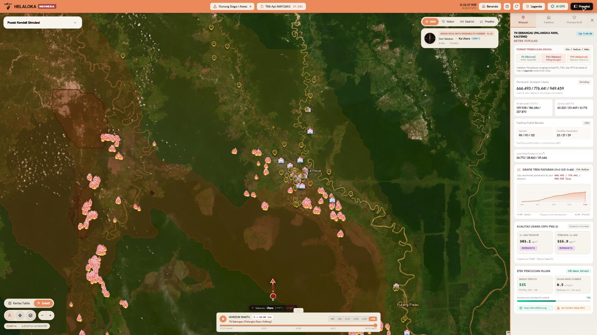
</div>

> [!IMPORTANT]
> HELALOKA adalah alat estimasi ilmiah untuk belajar, merencanakan, dan bersiap. HELALOKA **bukan peringatan resmi**. Untuk status bencana, perintah evakuasi, dan keputusan di lapangan, rujuk PVMBG Badan Geologi, BMKG, serta BNPB/BPBD.

## Daftar isi

1. [Masalah](#masalah)
2. [Ringkasan](#ringkasan)
3. [Fitur](#fitur)
4. [Tampilan](#tampilan)
5. [Coba dalam tiga langkah](#coba-dalam-tiga-langkah)
6. [Menjalankan secara lokal](#menjalankan-secara-lokal)
7. [Arsitektur](#arsitektur)
8. [Metode ilmiah](#metode-ilmiah)
9. [Validasi dan keterbatasan](#validasi-dan-keterbatasan)
10. [Sumber data](#sumber-data)
11. [API](#api)
12. [Pengujian](#pengujian)
13. [Struktur repositori](#struktur-repositori)
14. [Dokumentasi lain](#dokumentasi-lain)
15. [Tim](#tim)
16. [Lisensi dan atribusi](#lisensi-dan-atribusi)

## Masalah

Setiap musim kemarau, Indonesia menghadapi dua ancaman dari udara. Pada 2026 keduanya terjadi dalam satu bulan:

| Kejadian | Angka | Sumber |
| :--- | :--- | :--- |
| Asap karhutla, Palangka Raya, 30 September 2026 | PM2,5 **1.199 µg/m³**, kategori berbahaya (batas berbahaya 300) | detikHealth, data KLH |
| Infeksi saluran pernapasan akibat asap | **174.694 kasus ISPA**, 40 ribu di antaranya balita | Kemenkes melalui MerahPutih, 23 September 2026 |
| Abu letusan Anak Krakatau, 5 September 2026 | **8 bandara ditutup** | iNews melalui RCTI+, 7 September 2026 |

Datanya sebenarnya tersedia: titik api satelit, status gunung api, dan prakiraan angin. Yang terlambat adalah keputusan, karena data itu tersebar di banyak tempat dan belum diterjemahkan menjadi "siapa yang terdampak, kapan, dan apa yang harus dilakukan".

## Ringkasan

Saat gunung api meletus atau hutan terbakar, datanya sebenarnya sudah tersedia: titik api satelit, status gunung api, dan prakiraan angin. Yang sering terlambat adalah keputusan. HELALOKA menyatukan data tersebut menjadi satu ruang keputusan. Coba langsung di **[helaloka.up.railway.app](https://helaloka.up.railway.app/)**.

- **Satu mesin partikel untuk dua bahaya.** Abu vulkanik dan asap karhutla disimulasikan dengan mesin Lagrangian yang sama (integrasi Runge-Kutta orde 2).
- **Cakupan seluruh Indonesia.** 70 gunung api dengan level MAGMA, 36 kawasan hutan dan lahan gambut rawan api, serta titik bebas di peta.
- **Ketidakpastian ditampilkan apa adanya.** Simulasi berjalan sebagai ansambel cuaca (15 anggota, 51 untuk Anak Krakatau). Angka dampak selalu berupa rentang P5 / P50 / P95, tidak pernah satu angka tunggal.
- **Hasil yang bisa langsung dipakai.** Sekolah dan fasilitas kesehatan di jalur paparan, rute ke rumah sakit di luar jalur, ringkasan siap cetak, dan panduan untuk warga berdasarkan lokasi GPS.

## Fitur

| Fitur | Keterangan |
| :--- | :--- |
| Landing page dan loader | Scene 3D Three.js dengan tur gulir otomatis, lalu loader perjalanan sungai menuju aplikasi. |
| Mode nasional | Kerangka waktu data seluruh Indonesia: **Histori**, **Saat ini** (titik api FIRMS 24 jam), dan **Prediksi** (lintasan angin, asap, dan abu hingga 72 jam). |
| Pusat Kendali Simulasi | Pilih gunung api atau kawasan hutan, lalu jalankan dalam mode **Kondisi Nyata** (data langsung) atau **Uji Skenario** (tinggi kolom abu, arah angin, dan hujan dapat diubah; hasil diberi label skenario hipotetis). |
| Horizon waktu | Putar atau geser sebaran dari H+0 sampai H+48 jam dengan kontur peluang 90%, 50%, dan 5%. |
| Proyeksi: Wilayah | Penduduk, anak, dan lansia terpapar; sekolah dan fasilitas kesehatan berisiko; luas area; grafik tren paparan per jam; kualitas udara (CAMS/OpenAQ); efek pencucian hujan. |
| Proyeksi: Fasilitas | Daftar sekolah dan rumah sakit dengan peluang paparan dan jam tiba, rekomendasi PJJ daring, serta rute jalan OSRM ke rumah sakit di luar jalur paparan. |
| Proyeksi: Protokol & AI | Panduan tindakan dari model bahasa yang hanya memakai fakta terukur (titik api, lintasan angin, kualitas udara), ditambah standar masker Kemenkes. |
| Cetak Ringkasan | Pratinjau dokumen A4 dua halaman: peta sebaran, tabel dampak, serta daftar sekolah dan rumah sakit rujukan. |
| AI GPS | Warga cukup membuka ponsel untuk mengetahui status asap atau abu di lokasinya, perkiraan jam tiba, dan langkah untuk keluarga. |

## Tampilan

Semua gambar diambil dari aplikasi yang berjalan dengan data langsung pada 15 Oktober 2026.

| | |
| :---: | :---: |
| 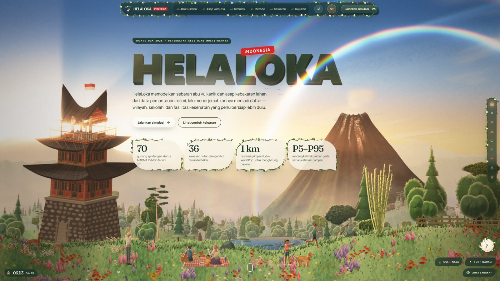<br/>**Landing page** dengan scene 3D dan tur gulir otomatis | 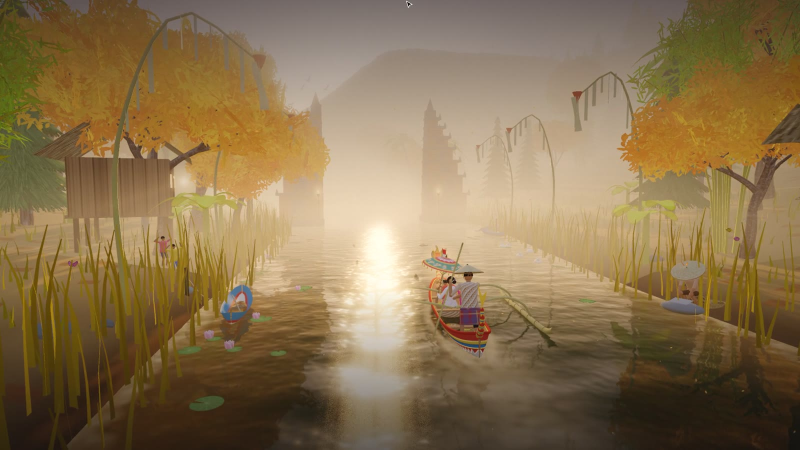<br/>**Loader 3D** perjalanan sungai menuju aplikasi |
| 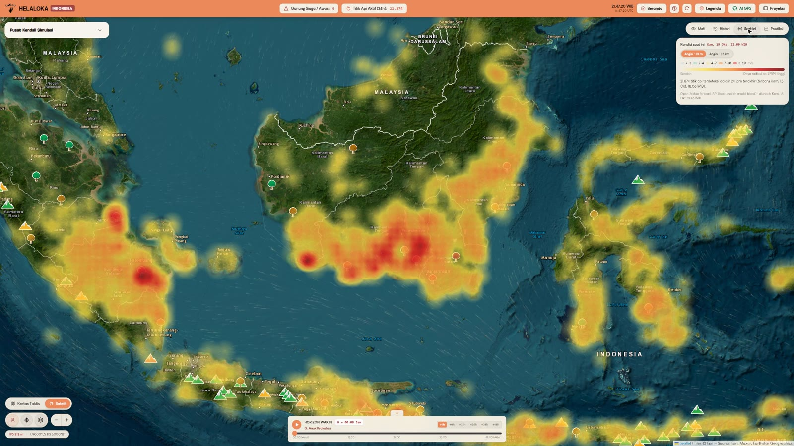<br/>**Mode Saat ini**: kepadatan titik api FIRMS 24 jam | 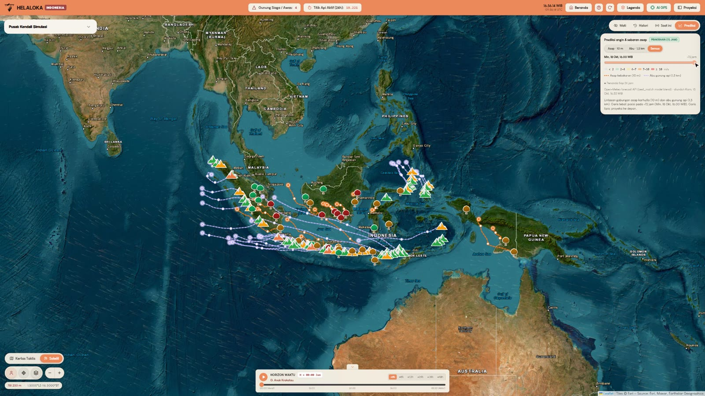<br/>**Mode Prediksi**: lintasan asap dan abu hingga 72 jam |
| 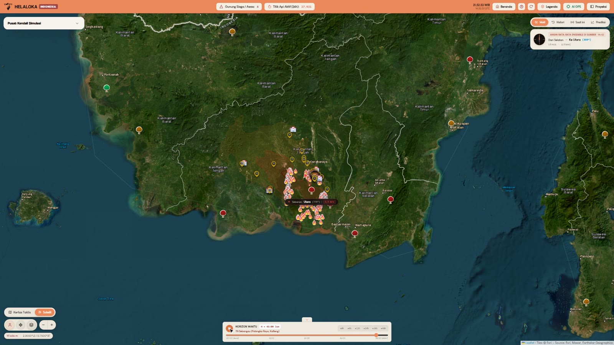<br/>**Simulasi karhutla** TN Sebangau, H+48 | <br/>**Proyeksi: Wilayah**, penduduk P5/P50/P95, fasilitas, grafik tren, kualitas udara |
| 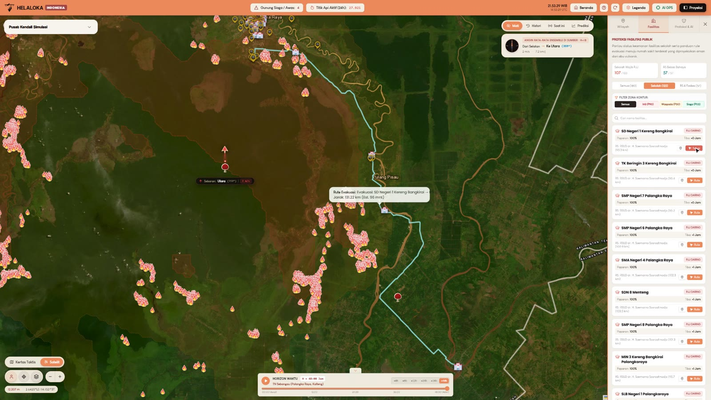<br/>**Proyeksi: Fasilitas**, sekolah berisiko dan rute OSRM ke rumah sakit | 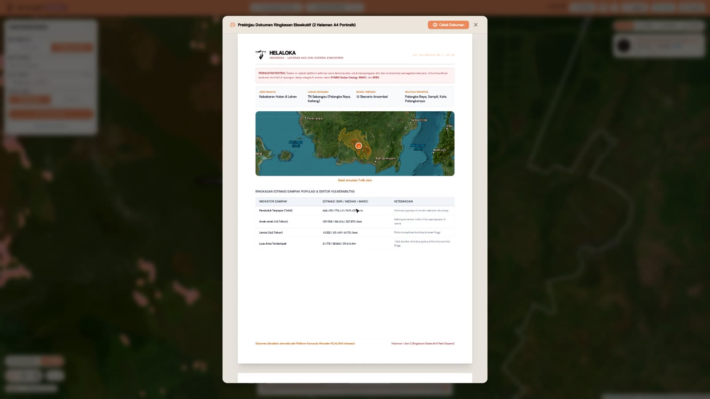<br/>**Cetak Ringkasan**: pratinjau dokumen A4 dua halaman |
| 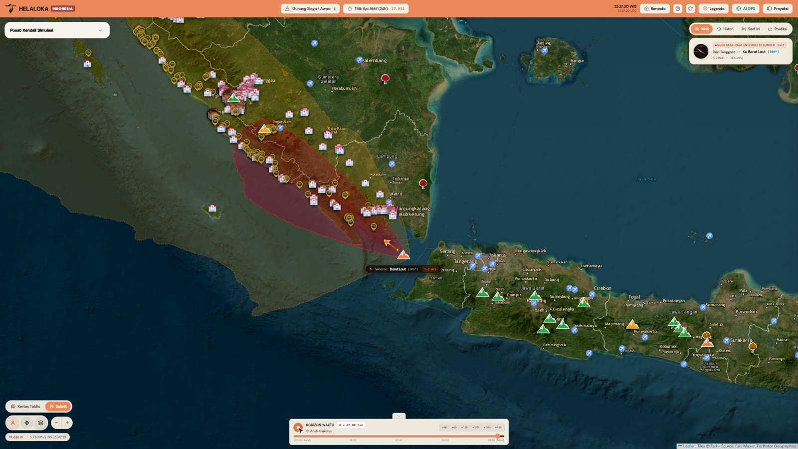<br/>**Uji Skenario** Anak Krakatau 15 km, sebaran abu H+48 | 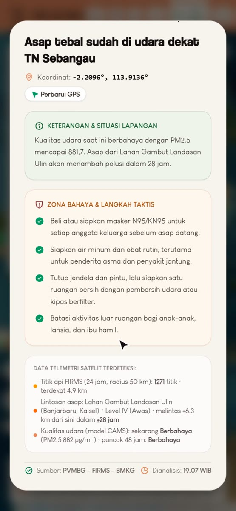<br/>**AI GPS** di ponsel warga: status asap, ISPU, dan langkah keluarga |

## Coba dalam tiga langkah

1. Buka **[helaloka.up.railway.app/app](https://helaloka.up.railway.app/app/)**, atau mulai dari landing page lalu tekan **Jalankan simulasi**.
2. Di **Pusat Kendali Simulasi**, pilih **Kebakaran Hutan**, lalu **TN Sebangau**, lalu **Mulai Simulasi**. Simulasi 15 anggota ansambel selesai dalam sekitar dua menit.
3. Tekan **Proyeksi** di header untuk melihat penduduk, sekolah, dan fasilitas kesehatan yang terpapar, lalu tab **Fasilitas** untuk rute ke rumah sakit dan **Cetak Ringkasan** untuk dokumen A4.

Untuk sudut pandang warga, buka aplikasi di ponsel dan tekan **AI GPS**. Untuk abu vulkanik, pilih **Gunung Api**, lalu **G. Anak Krakatau**, lalu **Uji Skenario**, dan geser tinggi kolom abu.

## Menjalankan secara lokal

Prasyarat: Python 3.10 atau lebih baru, dan Node.js 20 atau lebih baru.

**Windows, satu klik**

```cmd
run.bat
```

Skrip ini membuka backend (port 8000) dan frontend (port 5173) di jendela terpisah.

**Backend dan frontend bersamaan**

```bash
npm install
npm run dev
```

**Manual**

```bash
# Backend
cd backend
pip install -r requirements.txt
python -m uvicorn app.main:app --host 127.0.0.1 --port 8000 --reload

# Frontend (terminal lain)
cd frontend
npm install
npm run dev
```

| Alamat | Isi |
| :--- | :--- |
| http://localhost:5173 | Landing page |
| http://localhost:5173/app/ | Aplikasi simulasi |
| http://127.0.0.1:8000/docs | Dokumentasi API (Swagger) |
| http://127.0.0.1:8000/health | Status layanan |

**Konfigurasi.** Salin `backend/.env.example` menjadi `backend/.env`. Kunci API hanya disimpan di server dan tidak pernah dikirim ke frontend.

| Variabel | Wajib | Fungsi |
| :--- | :--- | :--- |
| `UDARASIAGA_OFFLINE` | ya | `0` untuk data langsung; `1` (bawaan) hanya memakai data lokal di `backend/data/events` |
| `FIRMS_MAP_KEY` | untuk data langsung | Titik api NASA FIRMS ([daftar gratis](https://firms.modaps.eosdis.nasa.gov/api/map_key/)) |
| `FEATHERLESS_API_KEY` | tidak | Ringkasan AI; tanpa kunci, ringkasan memakai templat deterministik |
| `FEATHERLESS_MODEL`, `FEATHERLESS_BASE_URL` | tidak | Mengganti model atau endpoint LLM |
| `OPENAQ_API_KEY` | tidak | Stasiun kualitas udara OpenAQ |

**Docker** (sama dengan yang dipakai di Railway):

```bash
docker build -t helaloka .
docker run -p 7860:7860 --env-file backend/.env helaloka   # http://localhost:7860
```

## Arsitektur

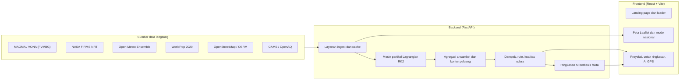

Tata letak aplikasi terdiri dari empat area:

| Area | Komponen | Isi |
| :--- | :--- | :--- |
| Header | `TacticalHeader.tsx` | Merek, jumlah gunung Siaga/Awas, titik api 24 jam, jam WIB/UTC, Legenda, AI GPS, Proyeksi |
| Pusat Kendali | `ControllerDock.tsx` | Jenis bencana, lokasi, mode, Mulai Simulasi, Cetak Ringkasan |
| Peta | `MapWorkspace.tsx`, `NationalModes.tsx`, `TimelinePlayer.tsx` | Peta satelit atau kertas taktis, lapisan spasial, mode nasional, horizon waktu |
| Proyeksi | `AnalyticsDrawer.tsx` dan `components/tabs/` | Tab Wilayah, Fasilitas, dan Protokol & AI |

## Metode ilmiah

| Komponen | Pendekatan | Rujukan |
| :--- | :--- | :--- |
| Laju massa erupsi | $\dot{M} = 140{,}85 \times H^{4{,}15}$ kg/s, dengan $H$ tinggi kolom di atas kawah (km) | Mastin dkk. (2009) |
| Emisi asap | PM2,5 dari Fire Radiative Power, FRP dirata-ratakan per lintasan satelit | Wooster dkk. (2005) |
| Transportasi | Adveksi RK2 titik tengah dengan angin ansambel multi-aras, ditambah difusi turbulen acak | |
| Pencucian hujan | $\Lambda = a \cdot R^{b}$ dengan $R$ intensitas hujan (mm/jam) | |
| Ketidakpastian | Peluang tiap sel dari seluruh anggota ansambel; dampak dilaporkan sebagai P5 / P50 / P95 | |

Mode Kondisi Nyata memakai sumber bertingkat sehingga semua gunung api dan kawasan hutan di katalog dapat disimulasikan. Urutannya: VONA berabu 24 jam terakhir, riwayat VONA, erupsi terakhir di Smithsonian GVP, lalu asumsi VEI 2. Untuk kebakaran: FIRMS 24 jam, hari kebakaran terakhir dalam 7 hari, lalu arsip VIIRS hingga 2 tahun. Tingkatan yang dipakai selalu ditampilkan di hasil. Rincian ada di [backend/README.md](backend/README.md) dan [backend/docs/SPEC.md](backend/docs/SPEC.md).

## Validasi dan keterbatasan

**Validasi.** Endpoint `GET /validation/{event_id}?run_id=` membandingkan hasil run dengan laporan dampak lapangan. Untuk letusan Anak Krakatau 5 September 2026, pembandingnya adalah wilayah yang dilaporkan terdampak hujan abu (BNPB melalui ANTARA, Kabupaten Lampung Selatan) dan koridor bandara. Skor hanya dihitung dari run yang benar-benar dijalankan, tidak ada skor tetap. Untuk karhutla belum ada data lapangan yang bisa dibandingkan, sehingga statusnya dilaporkan `not_testable`.

**Keterbatasan** yang sengaja ditampilkan apa adanya:
- Kategori ISPU dari model emisi belum dihitung, karena faktor emisi PM2,5 belum terverifikasi. Kualitas udara yang ditampilkan berasal dari model CAMS dan stasiun OpenAQ.
- Dampak lahan pertanian dan sumber air belum tersedia (belum ada data tutupan lahan), sehingga tidak ditampilkan.
- Ringkasan AI hanya merangkum fakta terukur dan perlu ditinjau manusia. Di tab Protokol & AI, ringkasan dibuat untuk titik sumber kejadian, belum memakai hasil simulasi.
- Kualitas simulasi bergantung pada prakiraan angin ansambel; rentang P5 sampai P95 menunjukkan seberapa besar ketidakpastian itu.

## Sumber data

| Data | Sumber | Pembaruan |
| :--- | :--- | :--- |
| Level gunung api dan VONA | MAGMA Indonesia, PVMBG Badan Geologi | tiap jam (level), 10 menit (VONA) |
| Titik api dan FRP | NASA FIRMS NRT (VIIRS S-NPP, NOAA-20, NOAA-21, MODIS) | tiap 15 menit |
| Angin dan hujan | Open-Meteo Ensemble, ECMWF IFS 0,25° | per run dan tiap 3 jam |
| Kualitas udara | Copernicus CAMS melalui Open-Meteo, stasiun OpenAQ | per permintaan |
| Penduduk | WorldPop 2020, grid 1 km | statis |
| Sekolah, faskes, bandara | OpenStreetMap melalui Overpass; cadangan basis data fasilitas nasional bila tile belum tersedia | cache 30 hari |
| Rute jalan | OSRM | per permintaan |
| Ringkasan AI | Featherless (Qwen), dengan cadangan templat deterministik | per permintaan |

Data yang belum tersedia (misalnya kategori ISPU dari model emisi, lahan pertanian, sumber air) tidak ditampilkan, bukan diisi angka perkiraan.

## API

Dokumentasi lengkap ada di [backend/docs/API_CONTRACT.md](backend/docs/API_CONTRACT.md) dan di `/docs` saat server berjalan.

| Endpoint | Fungsi |
| :--- | :--- |
| `POST /simulate` | Menjalankan simulasi ansambel |
| `GET /runs/{run_id}/tiers?t={jam}` | Kontur peluang per jam |
| `GET /runs/{run_id}/impact` | Penduduk, kelompok rentan, fasilitas, dan luas terpapar |
| `GET /runs/{run_id}/facilities-impacted` | Sekolah dan rumah sakit terdampak beserta rujukannya |
| `GET /runs/{run_id}/evacuation-route` | Rute jalan OSRM ke rumah sakit di luar jalur paparan |
| `GET /advice/nearby?lat=&lon=` | Ringkasan AI untuk satu lokasi |
| `GET /layers/{nama}`, `/layers/wind`, `/layers/smoke-paths`, `/layers/heatmap` | Lapisan peta dan data mode nasional |

## Pengujian

```bash
cd backend
pytest            # 44 tes: fisika, kontrak API, integritas data, basis data spasial
ruff check app tests
```

```bash
cd frontend
npm run build     # pemeriksaan tipe TypeScript dan build produksi
```

## Struktur repositori

```text
JOINTS2026/
├── README.md               Dokumen ini
├── CREDITS.md              Atribusi kode, aset, dan pustaka
├── LICENSE                 Lisensi MIT
├── Dockerfile              Image produksi (build frontend, lalu backend gunicorn); dipakai deploy Railway
├── render.yaml             Konfigurasi deploy Render (alternatif)
├── run.bat, run.ps1        Peluncur lokal untuk Windows
├── package.json            Menjalankan backend dan frontend bersamaan
├── scripts/                deploy_hf.ps1 (alternatif: deploy ke Hugging Face Spaces)
├── docs/                   Materi presentasi, arsitektur, dan screenshots/
├── backend/                API FastAPI dan mesin simulasi (lihat backend/README.md)
│   ├── app/                api, engine, impact, ingest, llm, services, db, schemas
│   ├── config/             Asumsi ilmiah dan parameter bahaya
│   ├── data/               Basis data SQLite dan lapisan spasial
│   ├── docs/               Spesifikasi, kontrak API, sumber data, basis data
│   └── tests/              Pengujian pytest
└── frontend/               Landing page dan aplikasi React (lihat frontend/README.md)
    ├── index.html          Landing page
    ├── app/                Halaman aplikasi (/app/)
    ├── loader/             Sumber loader 3D
    ├── public/             Aset statis, termasuk landing/
    └── src/                Kode React
```

## Dokumentasi lain

| Dokumen | Isi |
| :--- | :--- |
| [backend/README.md](backend/README.md) | Menjalankan backend, struktur kode, aturan data langsung |
| [backend/docs/SPEC.md](backend/docs/SPEC.md) | Spesifikasi teknis backend |
| [backend/docs/API_CONTRACT.md](backend/docs/API_CONTRACT.md) | Kontrak REST API |
| [backend/docs/SOURCES.md](backend/docs/SOURCES.md) | Verifikasi sumber data dan konstanta |
| [backend/docs/DATABASE_ARCHITECTURE.md](backend/docs/DATABASE_ARCHITECTURE.md) | Basis data spasial SQLite dan R*Tree |
| [frontend/README.md](frontend/README.md) | Menjalankan frontend dan struktur kode |
| [frontend/docs/LANDING.md](frontend/docs/LANDING.md) | Landing page dan riwayat perubahannya |
| [docs/PITCH_DECK.md](docs/PITCH_DECK.md) | Panduan pitch deck dan naskah presentasi |

## Tim

Tim **geminitolonggeneratemykisahstorysayauntuksaya** untuk Hackathon JOINTS UGM 2026. Kode sumber: [github.com/nyarikerja/JOINTS2026](https://github.com/nyarikerja/JOINTS2026).

## Lisensi dan atribusi

Kode dirilis dengan [lisensi MIT](LICENSE). Atribusi data, model, dan pustaka pihak ketiga tercantum di [CREDITS.md](CREDITS.md).
