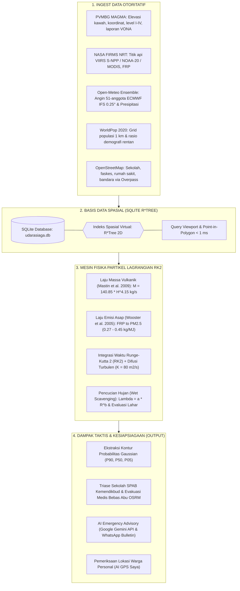

<div align="center">

  

  # 🌋 UdaraSiaga Indonesia 🌲
  ### Platform Komando Pemodelan Sebaran Atmosfer Multi-Bahaya & Sistem Pendukung Keputusan Aksi Dini

  <p align="center">
    <i>Satu Mesin Fisika Lagrangian Terpadu untuk Erupsi Gunung Api (Abu Silika) & Kebakaran Hutan/Lahan (Asap PM2.5) dengan Cakupan 1-Indonesia</i>
  </p>

  <p align="center">
    <b>Dikembangkan untuk Hackathon JOINTS UGM 2026</b><br/>
    <i>Track: Multi-Hazard Atmospheric Dispersion & Early Action Decision Support</i>
  </p>

  <!-- Badges -->
  <p align="center">
    
    
    
    
    
    
    
  </p>

  <p align="center">
    <a href="#-panduan-menjalankan-cepat-quickstart"><strong>Panduan Instalasi</strong></a> •
    <a href="#-fitur-utama-platform"><strong>Fitur Utama</strong></a> •
    <a href="#-arsitektur-antarmuka-the-4-zone-command-canvas"><strong>Arsitektur UI</strong></a> •
    <a href="#-alur-simulasi--metodologi-sains"><strong>Metodologi Fisika</strong></a> •
    <a href="#-katalog-data-otoritatif"><strong>Sumber Data</strong></a> •
    <a href="#-dokumentasi-rest-api"><strong>Dokumentasi API</strong></a>
  </p>

</div>

---

> [!IMPORTANT]
> **DISCLAIMER OTORITAS RESMI:**  
> **UdaraSiaga Indonesia** adalah platform estimasi sains terkomputasi untuk simulasi dinamika atmosferik, perencanaan kontinjensi, dan protokol kesiapsiagaan aksi dini (*Early Action Protocol*). Platform ini **BUKAN PERINGATAN DARURAT RESMI PEMERINTAH**.  
> Untuk penetapan status kedaruratan, penetapan status hukum bencana, dan komando evakuasi wajib di lapangan, seluruh instansi dan masyarakat **wajib merujuk pada arahan otoritatif resmi** dari **PVMBG Badan Geologi**, **BMKG**, dan **BNPB / BPBD**.

---

## 📖 Daftar Isi

1. [Tentang Platform UdaraSiaga](#-tentang-platform-udarasiaga)
2. [Panduan Menjalankan Cepat (Quickstart)](#-panduan-menjalankan-cepat-quickstart)
3. [Fitur Utama Platform](#-fitur-utama-platform)
4. [Arsitektur Antarmuka: The 4-Zone Command Canvas](#-arsitektur-antarmuka-the-4-zone-command-canvas)
5. [Alur Simulasi & Metodologi Sains](#-alur-simulasi--metodologi-sains)
6. [Katalog Data Otoritatif](#-katalog-data-otoritatif)
7. [Dokumentasi REST API](#-dokumentasi-rest-api)
8. [Verifikasi Sains, Akurasi & Pengujian](#-verifikasi-sains-akurasi--pengujian)
9. [Struktur Repositori](#-struktur-repositori)
10. [Lisensi & Atribusi](#-lisensi--atribusi)

---

## 🌟 Tentang Platform UdaraSiaga

Indonesia berada di pertemuan tiga lempeng tektonik aktif dunia (*Ring of Fire*) sekaligus memiliki hamparan lahan gambut terluas di Asia Tenggara. Ketika letusan gunung api atau kebakaran hutan/lahan terjadi, tantangan terbesar bagi garda depan kebencanaan (BPBD, Dinas Pendidikan, dan Dinas Kesehatan) bukanlah ketiadaan data satelit, melainkan **ketiadaan jembatan operasional antara data mentah sains dengan keputusan taktis di tingkat tapak**.

**UdaraSiaga Indonesia** hadir menjawab tantangan tersebut dengan:
- **Penyatuan Multi-Bahaya dalam Satu Mesin Fisika**: Menghapus fragmentasi sistem terpisah antara abu vulkanik dan asap karhutla melalui mesin partikel Lagrangian Runge-Kutta Ordo 2 (RK2).
- **Cakupan Penuh 1-Indonesia**: 70 Gunung Api Aktif PVMBG Tipe A, 36 Kawasan Hutan Konservasi & Lahan Gambut Kritis, serta simulasi titik bebas (*free-click*) di seluruh kepulauan Nusantara.
- **Kesiapsiagaan Berbasis Aksi Nyata**: Bukan sekadar peta visual pasif, melainkan pengambil keputusan taktis otomatis:
  1. **Triase Pendidikan**: Mandat pembelajaran jarak jauh (PJJ Daring) untuk sekolah terpapar sesuai standar SPAB Kemendikbud-BNPB.
  2. **Evakuasi Medis Bebas Abu**: Perutean ambulans darurat jalan raya nyata (OSRM) menuju rumah sakit aman di luar koridor paparan.
  3. **AI Kesiapsiagaan Personal & Media**: Google Gemini AI untuk draf siaran pers resmi BPBD dan buletin darurat WhatsApp warga tanpa emoji kasual, serta **AI GPS Saya** independen untuk proteksi personal keluarga.

---

## 🚀 Panduan Menjalankan Cepat (Quickstart)

Platform UdaraSiaga dirancang untuk kemudahan instalasi 1-klik (*Zero-Friction Launcher*).

### Opsi A: Peluncuran 1-Klik (Windows)
Cukup jalankan berkas batch otomatis di folder *root*:
```cmd
run.bat
```
*Script ini secara otomatis membuka jendela mandiri untuk Backend FastAPI (port 8000) dan Frontend Vite (port 5173).*

---

### Opsi B: Peluncuran Bersamaan via NPM
```bash
# Pasang dependensi dan jalankan backend + frontend secara paralel
npm install
npm run dev
```

---

### Opsi C: Peluncuran Manual Step-by-Step

#### 1. Menjalankan Backend (FastAPI Python)
Pastikan Python 3.10+ telah terpasang:
```bash
# 1. Pindah ke direktori backend
cd backend

# 2. Pasang dependensi
pip install -r requirements.txt

# 3. Jalankan server backend uvicorn
python -m uvicorn app.main:app --host 127.0.0.1 --port 8000 --reload
```
* Backend REST API: [http://127.0.0.1:8000/docs](http://127.0.0.1:8000/docs) (Interactive Swagger UI)
* Status Layanan & Telemetri: [http://127.0.0.1:8000/health](http://127.0.0.1:8000/health)

#### 2. Menjalankan Frontend (React + TypeScript + Vite)
Buka terminal baru:
```bash
# 1. Pindah ke direktori frontend
cd frontend

# 2. Pasang paket npm
npm install

# 3. Jalankan Vite dev server
npm run dev
```
* Dashboard Web Utama: [http://localhost:5173](http://localhost:5173)

#### 3. Menjalankan Pengujian Otomatis (*Test Suite*)
```bash
# Eksekusi seluruh 40 unit & physics test
pytest tests/

# Pemeriksaan linter kode Python (Ruff)
ruff check app/ tests/
```
*Hasil Verifikasi: **40/40 PASSED (100%)**, 0 error, 0 warning.*

---

## ⚡ Fitur Utama Platform

| Fitur | Deskripsi Teknis | Nilai Tambah & Dampak |
| :--- | :--- | :--- |
| **Mesin Fisika Lagrangian RK2** | Integrasi gerak partikel ordo 2 dengan adveksi angin ECMWF 51-anggota, difusi turbulen $80\text{ m}^2/\text{s}$, dan pencucian basah (*wet scavenging* $\Lambda = a R^b$). | Akurasi sebaran spasial teruji tanpa komputasi berat superkomputer. |
| **Kontur 3-Tingkat Ansambel** | Ekstraksi kontur Gaussian multi-probabilitas: **P90** (Hampir Pasti $\ge 90\%$), **P50** (Kemungkinan Besar $\ge 50\%$), dan **P05** (Mungkin Terkena $\ge 5\%$). | Menghilangkan kepalsuan angka tunggal; menyajikan rentang ketidakpastian ilmiah. |
| **Diferensiasi Multi-Bahaya** | Abu Vulkanik (Merah Silika `#ef4444`, Oranye `#f97316`) vs Asap Karhutla (Coklat Jelaga `#78350f`, Kuning Jerami `#a16207`). | Visual kognitif seketika: *Semakin tebal warna, semakin pekat konsentrasi partikulat*. |
| **Panah Telemetri Selaras Simbol** | Vektor arah gerak angin di episentrum otomatis mengikuti warna status bahaya gunung/hutan (Level I Hijau, Level II Kuning, Level III Oranye, Level IV Merah). | Menghilangkan kebingungan visual; panah arah sebaran 100% harmonis dengan ikon peta. |
| **AI GPS Saya (Personal Safety)** | Modal mandiri pendeteksi koordinat perangkat (`navigator.geolocation`) untuk mengecek apakah abu/asap mengarah ke lokasi tempat tinggal pengguna. | Akses 1-klik untuk warga tanpa perlu menjalankan simulasi gunung terlebih dahulu. Dilengkapi pemantau otomatis 15-menit. |
| **Triase SPAB Sekolah** | Evaluasi sekolah terpapar: Peluang $\ge 90\%$ (Instruksi PJJ Daring wajib), $\ge 50\%$ (Larangan kegiatan luar ruang). | Melindungi ribuan siswa dari paparan silikosis & ISPA akut sesuai kerangka SPAB Kemendikbud. |
| **Rute Evakuasi OSRM Jalan Nyata** | Perutean jalan raya berbelok riil menghubungkan sekolah/puskesmas ke RS rujukan di zona aman (bukan garis lurus menembus gunung/laut). | Estimasi jarak riil (km) dan waktu tempuh ambulans darurat (menit) yang realistis. |
| **Hybrid LLM Advisory Engine** | Narasi siaran pers media BPBD & buletin WhatsApp warga menggunakan Google Gemini API (model `gemini-2.0-flash`), Featherless LLM, dan fallback template deterministik. | Arsitektur tanpa gagal (*Zero-Failure*); anti-halusinasi dengan grounding fakta telemetri 100%. |

---

## 🎨 Arsitektur Antarmuka: The 4-Zone Command Canvas

Antarmuka web UdaraSiaga dibangun dengan filosofi **The 4-Zone Command Canvas** untuk meminimalkan beban kognitif (*cognitive load*) operator tanggap darurat:

```text
+---------------------------------------------------------------------------------------------------+
| ZONA A: TACTICAL COMMAND HEADER                                                                   |
| [Logo] UdaraSiaga  |  Status: SIAGA 24/7  |  KPI Satelit Langsung  |  AI GPS Saya  |  Reset  |  Laci |
+---------------------------------------------------------------------------------------------------+
| ZONA B: FLOATING CONTROLLER DOCK            | ZONA C: INTERACTIVE GIS WORKSPACE                   |
| (Kiri Atas Peta)                            |                                                     |
| - Pilihan Bahaya: Vulkanik / Karhutla       | - Peta Leaflet Dark / Exposure Canvas GPU           |
| - 70 Gunung Api MAGMA (Level I-IV)          | - Poligon Plume 3-Tingkat (P90 / P50 / P05)         |
| - 36 Kawasan Hutan & Lahan Gambut           | - Panah Vektor Angin Episentrum Selaras Level       |
| - Mode Otomatis / Coba-coba (Eksperimen)    | - Titik Hotspot FIRMS & KRB Geologi PVMBG           |
| - Tombol Eksekusi [Mulai Simulasi]          | +-------------------------------------------------+ |
|                                             | | TIMELINE PLAYER (T+0 s.d. T+48 Jam)             | |
|                                             | +-------------------------------------------------+ |
|                                             +-----------------------------------------------------+
|                                             | ZONA D: TABBED INSPECTION DOCK (Laci Kanan)         |
|                                             | [Tab 1: Wilayah] - Populasi & Kecamatan Kontainer   |
|                                             | [Tab 2: Fasilitas] - Sekolah SPAB & Rute Medis OSRM |
|                                             | [Tab 3: Protokol & AI] - Siaran Pers Gemini & Cetak |
+---------------------------------------------+-----------------------------------------------------+
```

### Rincian Setiap Zona:
1. **Zona A (Tactical Command Header)**:
   - Identitas platform resmi dan penunjuk waktu ganda presisi tinggi (**WIB** dan **UTC**).
   - Indikator telemetri nasional *live*: Gunung Level IV/III aktif dan Titik Api Satelit 24 Jam.
   - Tombol cepat **`AI GPS Saya`** (deteksi keselamatan personal mandiri), **`Reset Default`**, **`Legenda`**, dan **`Proyeksi Dampak`**.
2. **Zona B (Floating Controller Dock)**:
   - Panel melayang ergonomis di kiri atas peta (*glassmorphism card*) dengan akordeon intuitif.
   - Pilihan kejadian gunung berapi / kawasan hutan dengan penanda level warna otoritatif.
   - Kontrol eksperimen: tinggi kolom letusan ($1 - 25\text{ km}$), pembalik arah angin, dan intensitas hujan pencuci ($0 - 50\text{ mm/jam}$).
3. **Zona C (Interactive GIS Workspace)**:
   - Peta interaktif Leaflet GPU Canvas dengan dukungan *smooth zoom* dan *inertia physics*.
   - Marker penunjuk vektor angin dinamis di episentrum lengkap dengan *Telemetry Chip* arah sebaran dan kecepatan.
   - Kontur probabilitas sebaran partikel dan sebaran titik api satelit FIRMS.
   - Pemutar garis waktu (*Timeline Player*) melayang di bawah layar untuk scrubbing sebaran dari jam ke-0 ($T+0$) hingga jam ke-48 ($T+48$).
4. **Zona D (Tabbed Inspection Dock - Proyeksi Dampak)**:
   - Laci inspeksi geser (*slide-over*) di sisi kanan dengan 3 tab analitis terpadu:
     - **Tab Wilayah**: Estimasi populasi terpapar rentang P5–P50–P95, kelompok rentan anak & lansia, emisi karbon kebakaran hutan ($CO_2e$), dan peringatan lahar dingin.
     - **Tab Fasilitas**: Triase sekolah (PJJ daring) dan rumah sakit rujukan dengan visualisasi rute ambulans darurat jalan raya OSRM.
     - **Tab Protokol & AI**: Draf siaran pers resmi media BPBD, buletin darurat WhatsApp warga, standar APD masker respirator N95 Kemenkes, serta tombol cetak dokumen A4.

---

## 🔬 Alur Simulasi & Metodologi Sains



### Formula Matematika & Fisika yang Digunakan:

#### 1. Laju Pelepasan Massa Erupsi Vulkanik (*Mass Eruption Rate* / MER)
Menggunakan formulasi empiris internasional dari **Mastin et al. (2009)**:
$$\dot{M} = 140.85 \times H^{4.15} \quad [\text{kg/s}]$$
*Di mana $H$ adalah tinggi kolom letusan di atas kawah (km). Untuk mengakomodasi dinamika vulkanik non-linier, sistem menerapkan variasi stokastik lognormal.*

#### 2. Laju Emisi Partikulat $PM_{2.5}$ Kebakaran Hutan & Lahan
Menggunakan konversi *Fire Radiative Power* (FRP) dari **Wooster et al. (2005)**:
$$E_{PM2.5} = \text{FRP} \times C_{smoke} \quad [\text{kg/s}]$$
*Di mana $C_{smoke}$ dimodelkan menggunakan distribusi probabilitas segitiga ($0.27 - 0.37 - 0.45\text{ kg/MJ}$).*

#### 3. Adveksi & Difusi Atmosferik Partikel Lagrangian RK2
Posisi tiap paket partikel dihitung pada tiap langkah waktu $\Delta t$ menggunakan skema numerik Runge-Kutta Ordo 2 (titik tengah):
$$\vec{x}^* = \vec{x}(t) + \frac{1}{2} \Delta t \cdot \vec{u}(\vec{x}(t), t)$$
$$\vec{x}(t + \Delta t) = \vec{x}(t) + \Delta t \cdot \vec{u}(\vec{x}^*, t + \frac{1}{2}\Delta t) + \vec{\xi} \sqrt{2 K \Delta t}$$
*Di mana $\vec{u}$ adalah vektor kecepatan angin interpolasi ECMWF multi-aras dan $\vec{\xi} \sim \mathcal{N}(0, 1)$ adalah gangguan acak difusi turbulen atmosfer ($K = 80\text{ m}^2/\text{s}$).*

#### 4. Pencucian Partikel oleh Hujan (*Wet Scavenging*)
Fraksi partikel yang terendapkan oleh guyuran hujan dihitung melalui koefisien pencucian:
$$\Lambda = a \cdot R^b \quad [\text{s}^{-1}]$$
*Di mana $R$ adalah intensitas curah hujan ($\text{mm/jam}$), $a = 1.0 \times 10^{-4}$, dan $b = 0.8$.*

---

## 📊 Katalog Data Otoritatif

Seluruh informasi spasial dan meteorologi yang ditampilkan oleh platform ditarik langsung dari sumber resmi pemerintah dan lembaga sains internasional:

| Kategori | Parameter Data | Sumber Otoritatif | Pembaruan |
| :--- | :--- | :--- | :--- |
| **Vulkanologi** | Level aktivitas (I–IV), koordinat vent kawah, elevasi puncak, radius KRB, waktu erupsi VONA | **PVMBG Badan Geologi** (MAGMA Indonesia) | Tiap jam (Level) / 10 menit (VONA) |
| **Karhutla** | Titik api aktif (*hotspots*), radiasi daya termal (*Fire Radiative Power* / FRP), keyakinan deteksi | **NASA FIRMS NRT** (VIIRS S-NPP, NOAA-20, NOAA-21, MODIS) | Tiap 15 menit |
| **Meteorologi** | Vektor angin multi-aras ($u, v$), kecepatan, arah kardinal, curah hujan presipitasi | **Open-Meteo API** (ECMWF IFS 0,25°, 51 anggota ansambel) | Tiap 3 jam |
| **Demografi** | Estimasi kepadatan penduduk grid 1 km, proporsi rentan anak ($<15$ th) dan lansia ($\ge 65$ th) | **WorldPop 2020** (UN-adjusted) | Sensus Terbuka |
| **Aset Publik** | Titik koordinat sekolah dasar/menengah, puskesmas, klinik, rumah sakit rujukan, bandara | **OpenStreetMap Contributors** (via Overpass API) | Cache spasial 30 hari |
| **Jalan Raya** | Jaringan jalan raya berbelok riil untuk rute ambulans darurat | **OSRM (Open Source Routing Machine)** | Real-road routing |
| **Kecerdasan Buatan** | Pengayaan narasi siaran pers media & siaran buletin darurat warga | **Google Gemini API** (`gemini-2.0-flash` / `AQ.` key) & **Featherless AI** | *On-Demand* |

---

## 📡 Dokumentasi REST API

Backend FastAPI menyediakan antarmuka REST API berperforma tinggi. Dokumentasi interaktif OpenAPI Swagger dapat diakses di `http://127.0.0.1:8000/docs`.

### Ringkasan Endpoint Utama:

#### 1. Data Spasial & Titik Bahaya
- `GET /layers/volcanoes`: Mengambil daftar 70 gunung api lengkap dengan koordinat, elevasi, level MAGMA, dan radius bahaya KRB.
- `GET /layers/forests`: Mengambil daftar 36 kawasan hutan konservasi dengan sinkronisasi level bahaya I–IV berbasis titik api FIRMS 24 jam.
- `GET /layers/hotspots`: Mengambil titik api satelit NASA FIRMS (Filter BBOX atau per kawasan).
- `GET /layers/facilities`: Mengambil fasilitas publik (sekolah, faskes, bandara) dalam radius observasi.

#### 2. Eksekusi Simulasi
- `POST /simulation/run`: Menjalankan pemodelan dispersi partikel Lagrangian RK2.
  ```json
  {
    "hazard": "volcano",
    "event_id": "merapi_yogyakarta",
    "mode": "auto",
    "overrides": {
      "column_height_km": 12.0,
      "wind_reverse_troposphere": false,
      "rain_scavenging_mm_h": 0
    }
  }
  ```
- `GET /simulation/{run_id}/tiers`: Mengambil poligon kontur multi-probabilitas (P90, P50, P05) per jam simulasi.
- `GET /simulation/{run_id}/wind/{hour}`: Mengambil data vektor angin dan arah sebaran pada jam tertentu.

#### 3. Analisis Dampak & Aksi Dini
- `GET /runs/{run_id}/impact`: Mengambil estimasi populasi terpapar rentang P5–P50–P95, kelompok rentan anak/lansia, dan emisi karbon.
- `GET /runs/{run_id}/facilities`: Mengambil daftar sekolah terdampak triase PJJ daring dan rumah sakit rujukan di zona aman.
- `GET /runs/{run_id}/evacuation-route`: Menghitung rute jalan raya riil OSRM dari sekolah terdampak ke rumah sakit rujukan terdekat.
- `GET /runs/{run_id}/emergency-advisory`: Menghasilkan draf siaran pers resmi media BPBD dan broadcast WhatsApp warga via Google Gemini AI.

#### 4. Kesiapsiagaan Personal Warga
- `GET /advice/nearby?lat={lat}&lon={lon}&lang=id`: Menganalisis ancaman abu vulkanik atau asap karhutla pada koordinat GPS pengguna secara langsung.

---

## ✅ Verifikasi Sains, Akurasi & Pengujian

Platform UdaraSiaga menjalani pengujian ketat sebelum dirilis:
- **Pengujian Unit & Fisika**: 40 pengujian otomatis (*pytest*) mencakup validasi rumus Mastin, Wooster, integrasi RK2, dan penanganan kondisi batas darurat.
- **Validasi Lapangan Historis (FSS)**: Evaluasi kinerja spasial menggunakan metrik *Fractions Skill Score* (FSS) terhadap data sebaran erupsi historis Gunung Anak Krakatau 2026.
- **Kepatuhan Etika Data**:
  - Menolak interpolasi palsu kategori ISPU di luar jangkauan sensor stasiun pemantau fisik.
  - Tidak pernah menampilkan angka tunggal untuk populasi terdampak; selalu menyajikan rentang estimasi P5–P50–P95.
  - Memisahkan anomali termal kawah gunung api dari titik api kebakaran vegetasi.

---

## 📂 Struktur Repositori

```text
JOINTS2026/
├── run.bat                         # Peluncur 1-klik otomatis untuk Windows
├── run.ps1                         # Peluncur PowerShell
├── package.json                    # Script root dev runner (concurrently)
├── README.md                       # Dokumentasi induk platform (berkas ini)
├── CREDITS.md                      # Atribusi lisensi dan pustaka pihak ketiga
│
├── backend/                        # Layanan Mikro Sains & REST API (FastAPI)
│   ├── .env                        # Konfigurasi kunci API (Gemini, FIRMS, Featherless)
│   ├── requirements.txt            # Dependensi Python (FastAPI, NumPy, SciPy, Shapely)
│   ├── pytest.ini                  # Konfigurasi test suite
│   ├── app/
│   │   ├── main.py                 # Entry point server FastAPI
│   │   ├── api/                    # Handler rute REST API
│   │   │   ├── layers.py           # Endpoint gunung, hutan, hotspot, faskes
│   │   │   ├── simulation.py       # Endpoint eksekusi simulasi dispersi
│   │   │   ├── lapis2.py           # Endpoint dampak, rute OSRM, emisi karbon
│   │   │   └── advice.py           # Endpoint analisis koordinat GPS warga
│   │   ├── engine/                 # Inti komputasi fisika atmosfer
│   │   │   ├── simulator.py        # Mesin partikel Lagrangian RK2
│   │   │   └── mastin.py           # Formulasi MER erupsi vulkanik
│   │   ├── impact/                 # Modul analisis dampak & AI
│   │   │   └── gemini_advisory.py  # Google Gemini AI Advisory Engine
│   │   └── services/               # Integrasi API eksternal (MAGMA, FIRMS, Open-Meteo)
│   └── tests/                      # 40 berkas pengujian otomatis pytest
│
├── frontend/                       # Antarmuka Web Taktis (React 19 + TypeScript + Vite)
│   ├── index.html                  # Dokumen HTML utama
│   ├── vite.config.ts              # Konfigurasi Vite & Tailwind CSS
│   ├── package.json                # Dependensi frontend
│   ├── public/                     # Aset statis & logo
│   │   ├── gunung.png              # Logo resmi gunung api
│   │   ├── hutan.png               # Ikon kawasan hutan
│   │   ├── titik_api.png           # Ikon titik api satelit FIRMS
│   │   ├── school.png              # Ikon sekolah SPAB
│   │   └── hospital.png            # Ikon fasilitas kesehatan
│   └── src/
│       ├── App.tsx                 # Root layout container 4-zona
│       ├── main.tsx                # Entry point React
│       ├── index.css               # Desain sistem & tokens CSS
│       ├── components/
│       │   ├── layout/
│       │   │   ├── TacticalHeader.tsx    # Zona A: Header taktis, live ticker, jam ganda
│       │   │   ├── ControllerDock.tsx    # Zona B: Pusat kendali parameter simulasi
│       │   │   ├── MapWorkspace.tsx      # Zona C: Kanvas peta Leaflet & panah vektor
│       │   │   ├── TimelinePlayer.tsx    # Zona C: Slider scrubber waktu 48 jam
│       │   │   ├── AnalyticsDrawer.tsx   # Zona D: Laci samping analitik 3-tab
│       │   │   ├── GpsAdvisoryModal.tsx  # Modal mandiri AI GPS Saya (Personal Safety)
│       │   │   └── LegendModal.tsx       # Modal legenda resmi PVMBG & FIRMS
│       │   ├── tabs/
│       │   │   ├── TabImpact.tsx         # Tab 1: Dampak wilayah & populasi rentan
│       │   │   ├── TabFacilities.tsx     # Tab 2: Triase sekolah & rute evakuasi OSRM
│       │   │   └── TabProtocolAI.tsx     # Tab 3: Draf siaran pers Gemini & standar APD
│       │   └── ui/                       # Komponen mikro UI (akordeon, tombol, chip)
│       └── services/
│           └── api.ts                    # Klien HTTP type-safe menuju backend
│
└── docs/                           # Berkas presentasi, arsitektur, dan panduan lomba
    ├── Arsitektur_dan_Sumber_Data_UdaraSiaga.html
    └── Pembagian_Pitch_Deck_UdaraSiaga_v2_ContohVisual.md
```

---

## 📜 Lisensi & Atribusi

Proyek ini dilisensikan di bawah lisensi terbuka [MIT License](LICENSE).  
Seluruh atribusi data geospasial, model numerik, dan pustaka komputasi terbuka tercantum secara transparan di berkas [CREDITS.md](CREDITS.md).

---

<div align="center">
  <p><b>UdaraSiaga Indonesia — Mengubah Sains Atmosferik Menjadi Aksi Perlindungan Nyata Bagi Anak Bangsa</b></p>
  <p><i>Dikembangkan dengan dedikasi untuk Resiliensi Bencana Indonesia • JOINTS UGM 2026</i></p>
</div>
