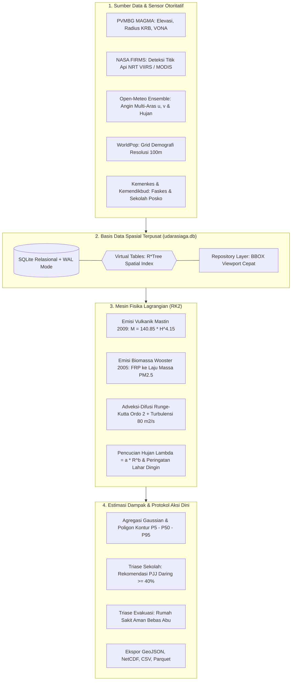
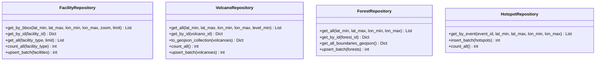

# UdaraSiaga: Backend Simulator Sebaran Abu Vulkanik & Asap Karhutla

Platform komputasi dan pemodelan dispersi partikulat atmosferik untuk erupsi gunung api dan kebakaran hutan/lahan berbasis mesin partikel Lagrangian terintegrasi. Dikembangkan untuk Hackathon JOINTS UGM 2026.

> **Pernyataan Penyangkalan (Disclaimer):**
> Aplikasi ini merupakan sistem pemodelan sains terkomputasi untuk pembelajaran, perencanaan mitigasi kontinjensi, dan protokol kesiapsiagaan aksi dini. Aplikasi ini **BUKAN PERINGATAN RESMI**. Untuk keputusan darurat dan status kebencanaan resmi di lapangan, seluruh pihak wajib merujuk pada arahan otoritatif dari Pusat Vulkanologi dan Mitigasi Bencana Geologi (PVMBG), Badan Meteorologi Klimatologi dan Geofisika (BMKG), dan Badan Nasional Penanggulangan Bencana (BNPB / BPBD).

---

## 1. Arsitektur Komputasi & Mesin Dispersi



---

## 2. Panduan Menjalankan Sistem

### Persyaratan Lingkungan
* Python versi 3.10 atau yang lebih baru.
* Sistem operasi: Linux, macOS, atau Microsoft Windows.

### Menjalankan Server Backend
```bash
# 1. Masuk ke direktori backend
cd backend

# 2. Pasang dependensi pustaka ilmiah
pip install -r requirements.txt

# 3. Jalankan server backend (FastAPI + Uvicorn)
python -m uvicorn app.main:app --host 127.0.0.1 --port 8000 --reload
```

* **Dokumentasi REST API Interaktif (Swagger UI)**: [http://127.0.0.1:8000/docs](http://127.0.0.1:8000/docs)
* **Dokumentasi ReDoc**: [http://127.0.0.1:8000/redoc](http://127.0.0.1:8000/redoc)
* **Pemeriksaan Kesehatan Sistem**: [http://127.0.0.1:8000/health](http://127.0.0.1:8000/health)
* **Antarmuka Pengujian Mandiri**: [http://127.0.0.1:8000/dummy](http://127.0.0.1:8000/dummy)

---

## 3. Eksekusi Pengujian Otomatis & Pemeriksaan Kode

Rangkaian pengujian terintegrasi mencakup validasi matematika fisika, skema Pydantic v2, endpoint API lapis 2 & 3, serta integritas kueri indeks spasial R\*Tree:

```bash
# Menjalankan seluruh pengujian unit dan sains (37 tes terdaftar)
pytest

# Menjalankan linter kode berbasis Ruff
ruff check app tests
```

*Status Verifikasi Saat Ini:* **37 passed in 5.47s**, 0 error, 0 warning linter.

---

## 4. Struktur Direktori Berstandar Best Practice

```
backend/
├── AGENTS.md                  # Prinsip integritas sains dan batasan rekayasa sistem
├── requirements.txt           # Dependensi pustaka Python produksi
├── pytest.ini                 # Konfigurasi rangkaian pengujian otomatis
├── app/
│   ├── api/                   # Router REST API (health, events, simulate, layers, attributions)
│   ├── core/                  # Konfigurasi, proteksi offline, generator nomor acak deterministik
│   ├── db/                    # Arsitektur basis data spasial terpusat
│   │   ├── __init__.py
│   │   ├── session.py         # Pengelola koneksi SQLite WAL mode berkinerja tinggi
│   │   ├── schema.py          # Definisi DDL tabel relasional, virtual R*Tree, dan pemicu
│   │   └── repositories/      # Pola akses data terisolasi (Clean Architecture)
│   │       ├── facility_repo.py  # Kueri BBOX R*Tree dan filter Level-of-Detail
│   │       ├── volcano_repo.py   # Manajemen 70 gunung api dan format GeoJSON
│   │       ├── forest_repo.py    # Manajemen 36 hutan dan geometri poligon batas riil
│   │       └── hotspot_repo.py   # Kueri titik api satelit NASA FIRMS
│   ├── engine/                # Mesin adveksi Runge-Kutta 2, difusi turbulen, wet scavenging
│   ├── impact/                # Estimasi dampak demografi WorldPop dan fasilitas publik
│   ├── ingest/                # Modul ingest telemetri (Open-Meteo, FIRMS, OSM Overpass)
│   ├── main.py                # Titik masuk aplikasi FastAPI dan lifespan otomatis
│   └── schemas/               # Validasi kontrak request/response Pydantic v2
├── config/
│   ├── assumptions.yaml       # Transparansi asumsi parameter ilmiah (D01 s.d. D24)
│   └── hazards.yaml           # Parameter fisik acuan vulkanik dan karhutla
├── data/
│   ├── udarasiaga.db          # Basis data terpusat SQLite dengan indeks R*Tree
│   ├── events/                # Direktori skenario kejadian siap pakai
│   ├── layers/                # Lapisan spasial nasional (katalog geojson & json)
│   └── runs/                  # Penyimpanan keluaran simulasi sementara
├── docs/
│   ├── API_CONTRACT.md        # Spesifikasi formal kontrak REST API
│   ├── DATABASE_ARCHITECTURE.md # Dokumentasi mendalam arsitektur basis data spasial
│   ├── SOURCES.md             # Laporan verifikasi empiris sumber primer
│   └── SPEC.md                # Spesifikasi teknis rancang bangun
├── frontend-dummy/            # Antarmuka GIS pengujian offline (Leaflet gelap mandiri)
├── scripts/
│   ├── db/
│   │   └── seed_database.py   # Skrip migrasi & inisialisasi basis data atomik
│   ├── generators/            # Generator dataset nasional (sekolah, bandara, gunung, hutan)
│   └── verification/          # Skrip verifikasi saintifik dan tolok ukur API
└── tests/
    ├── test_database.py       # Pengujian unit performa spasial R*Tree (< 25 ms)
    ├── test_integrity.py      # Pengujian kepatuhan kontrak dan integritas data
    ├── test_lapis2.py         # Pengujian endpoint simulasi dan estimasi dampak
    ├── test_lapis3.py         # Pengujian validasi historis dan analisis sensitivitas
    └── test_physics.py        # Pengujian persamaan Mastin 2009 dan konversi FRP Wooster
```

---

## 5. Ringkasan Basis Data Spasial Terkelola

Detail lengkap arsitektur basis data tersedia pada dokumen [docs/DATABASE_ARCHITECTURE.md](docs/DATABASE_ARCHITECTURE.md).



* **70 Gunung Api Aktif Tipe A**: Terdaftar dengan elevasi puncak, koordinat kawah, radius KRB, dan status aktivitas PVMBG.
* **36 Kawasan Hutan & Lahan Gambut**: Terdaftar dengan koordinat sentroid, luas hektare, tingkat kerawanan, dan poligon batas spasial resmi.
* **2.039 Fasilitas Publik Nasional**:
  * 1.332 Sekolah (SDN, SMPN, SMAN, SMKN) sebagai basis Tempat Evakuasi Sementara (TES) BPBD di 38 provinsi.
  * 628 Fasilitas Kesehatan (RSUP, RSUD rujukan, dan Puskesmas ring-1 tanggap darurat).
  * 79 Bandar Udara (komersial internasional, domestik utama, dan perintis Nusantara).
* **1.680 Titik Api Satelit**: Deteksi sensor satelit NASA FIRMS VIIRS & MODIS.
