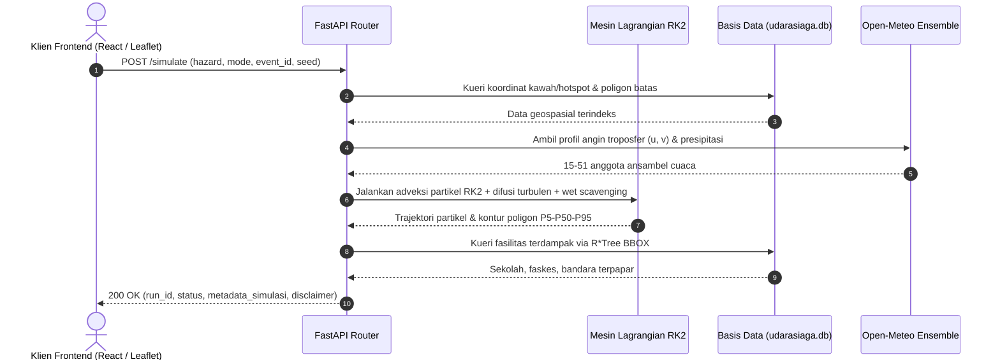

# UdaraSiaga API Contract

Dokumen kontrak antarmuka pemrograman aplikasi (API Contract) UdaraSiaga Backend.
Seluruh contoh respons bersumber dari fixture uji nyata di `docs/fixtures/`.

---

## 1. Ikhtisar & Standar Respons

1. **Format:** JSON (RESTful API), GeoJSON untuk lapisan spasial (RFC 7946).
2. **Prinsip Rentang (Prinsip 1):** Seluruh metrik dampak populasi, fasilitas, dan emisi selalu disajikan dalam rentang berstruktur:
   ```json
   {
     "min": 12000.0,
     "median": 45000.0,
     "max": 89000.0
   }
   ```
   (Merefleksikan persentil ketidakpastian P5, P50, dan P95 dari ansambel).
3. **Penolakan Overrides pada Mode Auto (Prinsip 3):** Endpoint `/simulate` menolak request ber-mode `auto` yang membawa `overrides` dengan status **HTTP 422 Unprocessable Entity**.
4. **Keberadaan Disclaimer Wajib (Prinsip 12):** Seluruh endpoint status, simulasi, dan dampak menyertakan field `disclaimer` resmi.
5. **Transparansi Asumsi (Prinsip 10 & 11):** Setiap run mengembalikan daftar parameter asumsi beserta status litbangnya (`sourced`, `sourced_range`, `modeling_choice`, `to_verify`, `assumption_placeholder`).
6. **Nonaktif ISPU bila Faktor Emisi Belum Valid (Prinsip 11):** Selama faktor emisi PM2.5 (D13b) berstatus placeholder, `ispu.available` bernilai `false` disertai `reason`.

---

## 2. Ringkasan Seluruh Endpoint Backend (Lapis 1, 2, 3 & Lapisan Spasial)

| Kategori | Method | Endpoint | Deskripsi Ringkas |
|---|---|---|---|
| **Sistem & Diagnostik** | `GET` | `/health` | Pemeriksaan kesehatan layanan, status offline, rincian sumber |
| **Sistem & Diagnostik** | `GET` | `/attributions` | Daftar atribusi sumber data terbuka (PVMBG, BMKG, NASA, WorldPop, OSM) |
| **Sistem & Diagnostik** | `GET` | `/limits` | Batas komputasi, batas domain spasial, dan transparansi asumsi ilmiah |
| **Sistem & Diagnostik** | `GET` | `/sources` | Katalog sumber data terbuka terverifikasi & status lisensi |
| **Katalog Kejadian** | `GET` | `/events` | Daftar lengkap kejadian siap pakai (70 Gunung Api + 36 Hutan Konservasi) |
| **Katalog Kejadian** | `GET` | `/events/{event_id}` | Rincian metadata geografis, elevasi, koordinat, dan status data kejadian |
| **Lapisan Peta (GIS)** | `GET` | `/layers/volcanoes-national` | Katalog spasial 70 gunung api aktif PVMBG se-Indonesia (GeoJSON) |
| **Lapisan Peta (GIS)** | `GET` | `/layers/forests-national` | Katalog spasial 36 kawasan hutan & konservasi nasional (JSON) |
| **Lapisan Peta (GIS)** | `GET` | `/layers/facilities` | Fasilitas publik nasional (sekolah, RS/faskes, bandara) dalam bbox |
| **Lapisan Peta (GIS)** | `GET` | `/layers/hotspots?event_id={id}` | Kluster titik api satelit NASA FIRMS (VIIRS & MODIS) |
| **Lapisan Peta (GIS)** | `GET` | `/layers/coastline` | Garis pantai kepulauan Nusantara resolusi tinggi (GeoJSON) |
| **Telemetri & Sinkronisasi** | `GET` | `/layers/summary-kpi` | Nilai telemetri KPI dinamis nasional (jumlah gunung per level, total hotspot) |
| **Telemetri & Sinkronisasi** | `POST` | `/layers/sync-live` | Pemicu sinkronisasi data cuaca & titik api langsung ke API eksternal |
| **Simulasi Partikel (L1)** | `POST` | `/simulate` | Eksekusi simulasi ansambel adveksi Lagrangian RK2 (Auto / Experiment) |
| **Simulasi Partikel (L1)** | `GET` | `/runs/{run_id}` | Status dan metadata hasil eksekusi simulasi |
| **Simulasi Partikel (L1)** | `GET` | `/runs/{run_id}/tiers?t={hour}` | Poligon GeoJSON sebaran abu/asap (P5/Max, P50/Mid, P90/Min) jam T+0 s.d. T+48 |
| **Simulasi Partikel (L1)** | `GET` | `/runs/{run_id}/particles` | Titik koordinat partikel individu untuk inspeksi & debug |
| **Estimasi Dampak (L1)** | `GET` | `/runs/{run_id}/impact` | Estimasi dampak agregat berentang `{min, median, max}` (penduduk & faskes) |
| **Estimasi Dampak (L1)** | `GET` | `/runs/{run_id}/facilities-impacted` | Rincian fasilitas publik terpapar, probabilitas, ETA, & rekomendasi |
| **Estimasi Dampak (L1)** | `GET` | `/runs/{run_id}/district-summaries` | Ringkasan dampak agregat per kabupaten/kota terdampak |
| **Fitur Pembeda (L2)** | `GET` | `/runs/{run_id}/ranking` | Peringkat prioritas klaster karhutla berdasarkan risiko paparan populasi |
| **Fitur Pembeda (L2)** | `POST` | `/fire/extinguish` | Simulasi interaktif kontra-faktual pemadaman titik api terpilih |
| **Fitur Pembeda (L2)** | `GET` | `/runs/{run_id}/carbon` | Estimasi pelepasan emisi karbon CO2e (lahan gambut vs non-gambut) |
| **Fitur Pembeda (L2)** | `GET` | `/runs/{run_id}/land-water` | Estimasi dampak abu vulkanik pada lahan pertanian dan air DAS |
| **Fitur Pembeda (L2)** | `GET` | `/runs/{run_id}/rain-effect` | Analisis komparatif pencucian polutan atmosfer oleh curah hujan |
| **Fitur Pembeda (L2)** | `POST` | `/runs/compare` | Komparasi berdampingan dua skenario simulasi yang berbeda |
| **Fitur Pembeda (L2)** | `POST` | `/runs/sensitivity` | Analisis sensitivitas sapuan parameter fisik (tinggi kolom, hujan) |
| **Fitur Pembeda (L2)** | `GET` | `/runs/{run_id}/advice` | Protokol aksi dini & rekomendasi operasional berbasis bukti |
| **Fitur Pembeda (L2)** | `GET` | `/runs/{run_id}/severity?t={h}` | Ringkasan metrik keparahan persentil beban abu/konsentrasi PM2.5 |
| **Fitur Pembeda (L2)** | `GET` | `/runs/{run_id}/arrival` | Peta waktu tiba (*time-of-arrival*) polutan per sektor wilayah |
| **Bukti Kepercayaan (L3)** | `GET` | `/validation/{event_id}` | Evaluasi validasi lapangan (District Hit Rate, FSS, dampak bandara) |
| **Bukti Kepercayaan (L3)** | `GET` | `/demo/play/{event_id}` | Urutan keyframe playback pratinjau otomatis untuk demonstrasi juri |
| **Bukti Kepercayaan (L3)** | `GET` | `/runs/{run_id}/export?format={json\|html}` | Ekspor ringkasan satu halaman (JSON terstruktur & HTML siap cetak) |
| **Bukti Kepercayaan (L3)** | `GET` | `/runs/{run_id}/lahar-warning` | Analisis peringatan dini potensi lahar hujan sekunder di DAS sungai |
| **Kesehatan Masyarakat (L3)** | `GET` | `/runs/{run_id}/health-guidance` | Rekomendasi masker (N95 vs bedah), peringatan lensa kontak, & kelompok rentan |
| **Kesiapsiagaan Dini (L3)** | `GET` | `/runs/{run_id}/decision-matrix` | Matriks pemicu aksi (*Trigger Action Matrix*) & checklist kesiapsiagaan |
| **Kesiapsiagaan Dini (L3)** | `GET` | `/runs/{run_id}/cross-border` | Analisis pelacakan risiko asap lintas batas (*Transboundary Haze*) |
| **Kesiapsiagaan Dini (L3)** | `GET` | `/runs/{run_id}/evacuation-routes` | Peta rute evakuasi aman dan penetapan zona larangan (KRB Buffer) |
| **Kesiapsiagaan Dini (L3)** | `GET` | `/runs/{run_id}/evacuation-route` | Rute jalan raya riil OSRM OpenStreetMap dari sekolah/faskes ke RS rujukan aman |
| **Kesiapsiagaan Dini (L3)** | `GET` | `/runs/{run_id}/emergency-advisory` | AI Emergency Briefing multi-sektor (Gemini AI & BNPB: Siaran Pers & WhatsApp) |


---

## 3. Rincian Endpoint & Contoh Nyata



### 3.1 Health Check: `GET /health`
- **Tujuan:** Memeriksa kesiapan sistem, mode operasi (online/offline), dan integritas disclaimer.
- **Contoh Respons (lihat `docs/fixtures/health.json`):**
```json
{
  "status": "healthy",
  "version": "0.1.0",
  "disclaimer": "PERINGATAN: UdaraSiaga adalah perangkat lunak kesiapsiagaan...",
  "offline_mode": false,
  "sources": {
    "openmeteo": "cached_offline",
    "firms": "cached_offline",
    "worldpop": "local_cog",
    "osm": "local_vector"
  }
}
```

---

### 3.2 Simulasi Ansambel: `POST /simulate`
- **Request Body (Mode Otomatis):**
```json
{
  "hazard": "volcano",
  "mode": "auto",
  "source": {
    "event_id": "anak_krakatau_2026_09"
  },
  "horizon_hours": 6,
  "n_members": 5,
  "seed": 42
}
```
- **Aturan Mode:**
  - `auto`: Menggunakan parameter rujukan/observasi tanpa modifikasi. Bila disertakan `overrides`, API menolak dengan HTTP 422.
  - `experiment`: Mengizinkan `overrides` (misal `column_height_km`, `wind_direction_reverse`, dsb.) dan mewajibkan label `scenario_label: "skenario hipotetis"`.
- **Contoh Respons (lihat `docs/fixtures/simulate_volcano.json`):**
```json
{
  "run_id": "sim_volcano_auto_...",
  "hazard": "volcano",
  "mode": "auto",
  "scenario_label": "analisis standar",
  "status": "completed",
  "progress_pct": 100.0,
  "members_source": "synthetic_spread",
  "n_members": 5,
  "horizon_hours": 6,
  "disclaimer": "PERINGATAN: UdaraSiaga...",
  "assumptions_used": [
    {
      "parameter": "mer_from_column_height",
      "status": "sourced",
      "source": "Mastin et al. 2009...",
      "caveat": null
    }
  ]
}
```

---

### 3.3 Tiga Tingkat Poligon Peluang: `GET /runs/{run_id}/tiers?t={hour}`
- **Query Params:** `t` (integer jam horizon, 0-48).
- **Format:** GeoJSON `FeatureCollection`.
- **Properti:** Tiga poligon dengan subset ketat $Min (P \ge 0.90) \subseteq Mid (P \ge 0.50) \subseteq Max (P \ge 0.05)$.
- **Contoh Respons (lihat `docs/fixtures/tiers_t12.json`):**
```json
{
  "type": "FeatureCollection",
  "features": [
    {
      "type": "Feature",
      "geometry": { "type": "Polygon", "coordinates": [...] },
      "properties": {
        "tier": "maximum",
        "threshold": 0.05,
        "probability_label": "P5 (Peluang Rendah, Jangkauan Terjauh)",
        "hour": 6
      }
    },
    {
      "type": "Feature",
      "geometry": { "type": "Polygon", "coordinates": [...] },
      "properties": {
        "tier": "median",
        "threshold": 0.5,
        "probability_label": "P50 (Peluang Sedang)",
        "hour": 6
      }
    },
    {
      "type": "Feature",
      "geometry": { "type": "Polygon", "coordinates": [...] },
      "properties": {
        "tier": "minimum",
        "threshold": 0.9,
        "probability_label": "P90 (Peluang Tinggi, Area Inti)",
        "hour": 6
      }
    }
  ]
}
```

---

### 3.4 Estimasi Dampak Populasi: `GET /runs/{run_id}/impact`
- **Contoh Respons (lihat `docs/fixtures/impact_volcano.json`):**
```json
{
  "run_id": "sim_volcano_auto_...",
  "hazard": "volcano",
  "population_exposed": { "min": 2420.0, "median": 8650.0, "max": 18400.0 },
  "children_exposed": { "min": 605.0, "median": 2162.5, "max": 4600.0 },
  "elderly_exposed": { "min": 193.6, "median": 692.0, "max": 1472.0 },
  "area_exposed_km2": { "min": 120.5, "median": 340.2, "max": 680.8 },
  "schools_exposed": { "min": 2, "median": 5, "max": 12 },
  "healthcare_exposed": { "min": 0, "median": 2, "max": 4 },
  "ispu": {
    "available": false,
    "reason": "D13b PM2.5 emission factor is currently placeholder; ISPU category calculation withheld."
  },
  "disclaimer": "PERINGATAN: UdaraSiaga..."
}
```

---

### 3.5 Peringkat Klaster Titik Api: `GET /runs/{run_id}/ranking`
- **Tujuan:** Mengurutkan klaster titik api berdasarkan dampak paparan asap ke permukiman penduduk di jalur angin.
- **Contoh Respons (lihat `docs/fixtures/ranking_fire.json`):**
```json
{
  "run_id": "sim_fire_auto_...",
  "hazard": "fire",
  "cluster_count": 8,
  "ranked_clusters": [
    {
      "cluster_id": 1,
      "rank": 1,
      "center_lat": -2.341,
      "center_lon": 113.621,
      "hotspot_count": 42,
      "total_frp_mw": 1420.5,
      "peat_fraction": 0.85,
      "exposure_contribution_score": 88.4
    }
  ]
}
```

---

### 3.6 Pemadaman Kontra-faktual: `POST /fire/extinguish`
- **Request Body:**
```json
{
  "run_id": "sim_fire_auto_...",
  "extinguish_cluster_ids": [1]
}
```
- **Contoh Respons (lihat `docs/fixtures/extinguish_fire.json`):**
```json
{
  "original_run_id": "sim_fire_auto_...",
  "extinguished_clusters": [1],
  "population_reduced": { "min": 850.0, "median": 2840.0, "max": 6200.0 },
  "carbon_reduced_co2e_tonnes": { "min": 320.0, "median": 740.0, "max": 1150.0 },
  "reduction_percentage": 24.5
}
```

---

### 3.7 Estimasi Emisi Karbon: `GET /runs/{run_id}/carbon`
- **Dasar Formula:** Wooster et al. 2005 & Andreae & Merlet, membedakan koefisien emisi gambut vs non-gambut.
- **Contoh Respons (lihat `docs/fixtures/carbon_fire.json`):**
```json
{
  "run_id": "sim_fire_auto_...",
  "hazard": "fire",
  "total_co2e_tonnes": { "min": 1450.0, "median": 3120.0, "max": 5890.0 },
  "peat_emissions_tonnes": { "min": 1100.0, "median": 2400.0, "max": 4600.0 },
  "non_peat_emissions_tonnes": { "min": 350.0, "median": 720.0, "max": 1290.0 },
  "source": "Wooster et al. 2005; Li et al. 2018 (FRP to Dry Matter)"
}
```

---

### 3.8 Dampak Lahan & Air: `GET /runs/{run_id}/land-water`
- **Tujuan:** Menghitung luas lahan pertanian tertimpa abu dan titik sumber air terdampak, dengan peringatan abu basah & lahar hujan.
- **Contoh Respons (lihat `docs/fixtures/land_water.json`):**
```json
{
  "run_id": "sim_volcano_auto_...",
  "cropland_exposed_ha": { "min": 310.0, "median": 1050.0, "max": 2400.0 },
  "water_sources_exposed_count": { "min": 1, "median": 4, "max": 9 },
  "ash_wetness_warning": "PERINGATAN: Endapan abu berinteraksi dengan hujan meningkatkan beban atap hingga 2x lipat dan memicu potensi aliran lahar sekunder di aliran sungai.",
  "lahar_hazard_zones": ["DAS Kali Gendol", "DAS Kali Woro"]
}
```

---

### 3.9 Efek Pencucian Hujan: `GET /runs/{run_id}/rain-effect`
- **Dasar Formula:** Model scavenging presipitasi $\Lambda = a \cdot R^b$.
- **Contoh Respons (lihat `docs/fixtures/rain_effect.json`):**
```json
{
  "run_id": "sim_volcano_auto_...",
  "population_exposure_reduced": { "min": 450.0, "median": 1320.0, "max": 3100.0 },
  "area_footprint_reduced_km2": { "min": 18.0, "median": 45.0, "max": 92.0 },
  "hazard_specific_warning": "Pembersihan udara oleh hujan memindahkan bahaya partikulat di udara menjadi endapan lumpur abu di permukaan tanah."
}
```

---

### 3.10 Komparasi Skenario Berdampingan: `POST /runs/compare`
- **Request Body:**
```json
{
  "run_id_a": "sim_volcano_auto_...",
  "run_id_b": "sim_volcano_exp_..."
}
```
- **Contoh Respons (lihat `docs/fixtures/compare_runs.json`):**
```json
{
  "run_a": {
    "run_id": "sim_volcano_auto_...",
    "mode": "auto",
    "population_median": 8650.0
  },
  "run_b": {
    "run_id": "sim_volcano_exp_...",
    "mode": "experiment",
    "population_median": 14200.0
  },
  "deltas": {
    "population_delta_median": 5550.0,
    "area_delta_km2": 182.4
  }
}
```

---

### 3.11 Analisis Sensitivitas Parameter: `POST /runs/sensitivity`
- **Request Body:**
```json
{
  "run_id": "sim_volcano_auto_...",
  "parameter_name": "column_height_km"
}
```
- **Contoh Respons (lihat `docs/fixtures/sensitivity.json`):**
```json
{
  "run_id": "sim_volcano_auto_...",
  "parameter": "column_height_km",
  "sensitivity_curve": [
    { "multiplier": 0.6, "value": 7.2, "population_exposed_median": 4100.0 },
    { "multiplier": 0.8, "value": 9.6, "population_exposed_median": 6200.0 },
    { "multiplier": 1.0, "value": 12.0, "population_exposed_median": 8650.0 },
    { "multiplier": 1.2, "value": 14.4, "population_exposed_median": 12800.0 },
    { "multiplier": 1.4, "value": 16.8, "population_exposed_median": 17900.0 }
  ]
}
```

---

### 3.12 Saran Tindakan Terverifikasi: `GET /runs/{run_id}/advice`
- **Aturan (Prinsip 11 & AGENTS.md):** Hanya menyajikan rekomendasi yang bersumber dari pedoman resmi (contoh D16: IVHHN/Kemenkes). Saran yang belum tervalidasi ditandai `available: false`.
- **Contoh Respons (lihat `docs/fixtures/advice.json`):**
```json
{
  "run_id": "sim_volcano_auto_...",
  "sourced_advice": [
    {
      "action": "Gunakan masker berstandar partikulat (N95 / FFP2) saat beraktivitas di luar ruangan untuk mencegah iritasi saluran pernapasan dari partikel abu halus (<2.5 µm).",
      "source": "IVHHN (International Volcanic Health Hazard Network) / Kemenkes RI",
      "verified_on": "2026-10-05"
    },
    {
      "action": "Tutup rapat tandon dan penampungan air bersih agar tidak tercemar endapan debu vulkanik yang bersifat asam.",
      "source": "Pedoman Penanganan Erupsi Gunung Api BNPB",
      "verified_on": "2026-10-05"
    }
  ],
  "additional_guidance": {
    "available": false,
    "reason": "Rekomendasi spesifik evakuasi mikro wilayah ditahan sampai adanya instruksi dari Pos Pengamatan PVMBG / BPBD setempat."
  }
}
```

---

### 3.13 Evaluasi Validasi Lapangan: `GET /validation/{event_id}`
- **Tujuan:** Menguji akurasi model terhadap data dampak aktual (reported impact) dan memeriksa batasan stasiun pembanding.
- **Contoh Respons Gunung (lihat `docs/fixtures/validation_krakatau.json`):**
```json
{
  "event_id": "anak_krakatau_2026_09",
  "hazard": "volcano",
  "resolution": "district",
  "validation_note": "Validasi kasar pada tingkat kabupaten dan dampak penerbangan bandara.",
  "members_source": "synthetic_from_mean_spread",
  "reported_districts_evaluated": [
    "Kabupaten Lampung Selatan",
    "Kabupaten Tanggamus",
    "Kabupaten Pandeglang"
  ],
  "district_hit_rate": 1.0,
  "fractions_skill_score": 0.74,
  "aviation_impact": {
    "airport_name": "Bandara Radin Inten II (TKG)",
    "label": "dampak penerbangan",
    "airspace_exposure_probability": 0.68,
    "dispersion_altitude_fl": "FL100 - FL250"
  },
  "grid_search_spread_inflation": [
    { "inflation_factor": 0.8, "fss": 0.68, "district_overlap_pct": 66.7 },
    { "inflation_factor": 1.0, "fss": 0.74, "district_overlap_pct": 100.0 },
    { "inflation_factor": 1.2, "fss": 0.75, "district_overlap_pct": 100.0 }
  ],
  "confidence_caveat": "Anggota ensemble bersifat sintetis dari mean/spread..."
}
```
- **Contoh Respons Kebakaran Tanpa Stasiun (lihat `docs/fixtures/validation_kalimantan.json`):**
```json
{
  "event_id": "live_kalimantan",
  "hazard": "fire",
  "status": "not_testable",
  "reason": "Stasiun pemantau kualitas udara kontinu (ISPU/OpenAQ) dengan riwayat sinkron tidak tersedia di sekitar pusat titik api untuk periode ini.",
  "validation_note": "Tanpa data stasiun pembanding, model tidak mengklaim akurasi mutlak dan disajikan sebagai simulasi dispersi skenario.",
  "accuracy_claim": "none"
}
```

---

### 3.14 Batasan Sistem & Domain: `GET /limits`
- **Tujuan:** Menampilkan batasan fisik komputasi, batasan geospasial, dan ringkasan status bukti asumsi pemodelan.
- **Contoh Respons (lihat `docs/fixtures/limits.json`):**
```json
{
  "computational_limits": {
    "max_bbox_degrees": "6.0 x 6.0",
    "max_horizon_hours": 48,
    "max_ensemble_members": 100,
    "max_concurrent_runs": 2,
    "firms_rate_limit_per_10min": 5000,
    "firms_max_query_span_days": 5
  },
  "tier_thresholds": {
    "minimum": { "threshold": 0.90, "label": "P90 (Peluang Tinggi, Area Inti)" },
    "median": { "threshold": 0.50, "label": "P50 (Peluang Sedang)" },
    "maximum": { "threshold": 0.05, "label": "P5 (Peluang Rendah, Jangkauan Terjauh)" }
  },
  "assumptions_summary": {
    "total_assumptions": 10,
    "by_status": {
      "sourced": 1,
      "sourced_secondary": 1,
      "sourced_range": 1,
      "modeling_choice": 2,
      "to_verify": 1,
      "assumption_placeholder": 4
    }
  }
}
```

---

### 3.15 Katalog Sumber Data: `GET /sources`
- **Tujuan:** Menyajikan katalog lengkap sumber data terbuka terverifikasi, lisensi, dan dokumentasi markdown `SOURCES.md`.
- **Contoh Respons (lihat `docs/fixtures/sources.json`):**
```json
{
  "title": "Katalog Sumber Data UdaraSiaga",
  "verified_sources": [
    { "id": "D01", "name": "Open-Meteo Weather API", "status": "S", "license": "CC BY 4.0" },
    { "id": "D03", "name": "NASA FIRMS (MODIS & VIIRS)", "status": "S", "license": "NASA Open Data Policy" },
    { "id": "D09", "name": "WorldPop Population Density", "status": "S", "license": "CC BY 4.0" },
    { "id": "D18", "name": "OpenStreetMap / Overpass API", "status": "S", "license": "ODbL 1.0" },
    { "id": "D24", "name": "Mastin et al. 2009 (JVGR)", "status": "S", "license": "Scientific Publication" }
  ]
}
```

---

### 3.16 Urutan Putar Demo Otomatis: `GET /demo/play/{event_id}`
- **Tujuan:** Menyediakan rangkaian timeline keyframes pra-komputasi untuk demonstrasi juri tanpa jeda komputasi.
- **Contoh Respons (lihat `docs/fixtures/demo_play.json`):**
```json
{
  "event_id": "anak_krakatau_2026_09",
  "hazard": "volcano",
  "total_duration_hours": 48,
  "step_interval_hours": 6,
  "steps": [
    { "hour": 0, "time_label": "T + 00:00 Jam", "commentary": "Fase letusan awal..." },
    { "hour": 12, "time_label": "T + 12:00 Jam", "commentary": "Awan abu telah menyebar sejauh ~180 km..." }
  ]
}
```

---

### 3.17 Ekspor Ringkasan Satu Halaman: `GET /runs/{run_id}/export`
- **Query Params:** `format` (`json` atau `html`).
- **Format HTML:** Menghasilkan dokumen HTML mandiri siap cetak (*print-ready*) dengan styling `@media print`, tabel rentang dampak, saran D16, tabel transparansi asumsi, dan disclaimer resmi.
- **Format JSON (lihat `docs/fixtures/export_summary.json`):**
```json
{
  "run_id": "sim_volcano_auto_...",
  "hazard": "volcano",
  "mode": "auto",
  "impact": {
    "population_exposed": { "min": 2420.0, "median": 8650.0, "max": 18400.0 }
  },
  "advice": { ... },
  "assumptions_used": [ ... ],
  "disclaimer": "PERINGATAN: UdaraSiaga..."
}
```

---

### 3.18 Peringatan Bahaya Lahar Hujan: `GET /runs/{run_id}/lahar-warning`
- **Tujuan:** Menganalisis risiko mobilisasi lahar sekunder akibat interaksi curah hujan tinggi dengan endapan abu piroklastik.
- **Contoh Respons (lihat `docs/fixtures/lahar_warning.json`):**
```json
{
  "run_id": "sim_volcano_auto_...",
  "hazard": "volcano",
  "lahar_risk_level": "waspada",
  "rainfall_threshold_trigger_mm_h": 20.0,
  "critical_ash_thickness_mm": 5.0,
  "vulnerable_drainage_basins": [
    { "river_name": "DAS Way Sekampung (Lampung)", "risk": "sedang" },
    { "river_name": "DAS Ci Asahan (Banten)", "risk": "rendah" }
  ],
  "warning_text": "PERINGATAN LAHAR HUJAN: Hujan dengan intensitas melampaui 20 mm/jam..."
}
```

---

### 3.19 Rute Evakuasi Jalan Raya Riil OSRM: `GET /runs/{run_id}/evacuation-route`
- **Tujuan:** Menghitung koridor rute evakuasi jalan raya riil berbelok (bukan garis lurus) dari fasilitas asal (sekolah/faskes) ke rumah sakit rujukan aman terdekat menggunakan OpenStreetMap Routing Machine (OSRM).
- **Query Params:**
  - `from_lat` (float, wajib): Lintang titik asal
  - `from_lon` (float, wajib): Bujur titik asal
  - `to_lat` (float, wajib): Lintang RS rujukan
  - `to_lon` (float, wajib): Bujur RS rujukan
  - `from_name` (string, opsional): Nama fasilitas asal
  - `to_name` (string, opsional): Nama RS rujukan
- **Contoh Respons:**
```json
{
  "status": "success",
  "from_name": "SDN 1 Sambirejo",
  "to_name": "RSUD Sleman",
  "distance_km": 21.4,
  "duration_minutes": 32.5,
  "mode": "osrm_real_road",
  "route_coordinates": [
    [-7.7812, 110.4912],
    [-7.7805, 110.4901],
    [-7.7782, 110.4850],
    [-7.6890, 110.3421]
  ],
  "turn_by_turn": [
    { "instruction": "Mulai dari SDN 1 Sambirejo menuju Jl. Raya Prambanan", "distance_m": 450, "duration_s": 60 },
    { "instruction": "Belok kanan ke Jl. Magelang", "distance_m": 12400, "duration_s": 980 }
  ],
  "disclaimer": "Rute ini dihasilkan dari jaringan jalan OpenStreetMap..."
}
```

---

### 3.20 AI Emergency Advisory Multi-Sektor: `GET /runs/{run_id}/emergency-advisory`
- **Tujuan:** Perumusan protokol taktis tanggap darurat resmi dan materi komunikasi publik secara otomatis (didukung Google Gemini API dengan fallback deterministik standar Pusdalops BNPB tanpa emoji bebas spekulasi).
- **Contoh Respons:**
```json
{
  "run_id": "sim_volcano_auto_...",
  "alert_level": "SIAGA TANGGAP DARURAT",
  "badge_bg": "#dc2626",
  "scenario_label": "G. Anak Krakatau - Level III (SIAGA)",
  "population_summary": {
    "total_median": 8650.0,
    "children_median": 1820.0,
    "elderly_median": 910.0,
    "priority_districts": ["Kecamatan Rajabasa", "Kecamatan Kalianda", "Kecamatan Bakauheni"]
  },
  "gemini_briefing": {
    "engine": "Google Gemini AI (gemini-1.5-flash)",
    "status": "ai_generated",
    "press_release_title": "SIARAN PERS PUSDALOPS BPBD: PERINGATAN DINI KESIAPSIAGAAN ANCAMAN ERUPSI G. ANAK KRAKATAU",
    "press_release_body": "Pusat Pengendalian Operasi Badan Penanggulangan Bencana Daerah (Pusdalops BPBD) bersama Dinas Kesehatan menerbitkan peringatan kesiapsiagaan dini menyusul dinamika aktivitas erupsi gunung api pada skenario G. Anak Krakatau - Level III (SIAGA)...",
    "whatsapp_broadcast": "PEMBERITAHUAN RESMI PUSDALOPS BPBD & DINAS KESEHATAN\nNomor: 360/PUSDALOPS/DARURAT/G._ANAK_KRAKATAU\nPerihal: Arahan Kesiapsiagaan Dini Paparan Erupsi Gunung Api\n\nWilayah Prioritas Pengawasan: Kecamatan Rajabasa, Kalianda, Bakauheni\nEstimasi Warga Terpapar: 8,650 jiwa (Mencakup 1,820 anak-anak dan 910 lansia)\n\nInstruksi Perlindungan Diri dan Lingkungan:\n1. Standar Perlindungan Pernapasan: Wajib menggunakan respirator partikulat N95/KN95/KF94 dengan klip hidung tertutup rapat. Masker kain dan masker bedah dilarang sebagai pelindung utama karena memiliki kebocoran samping hingga 50%.\n2. Perlindungan Mata: Dilarang keras memakai lensa kontak (softlens). Debu abu silika (SiO2) bersifat tajam dan abrasif yang dapat merobek kornea mata (abrasi kornea) dan memicu kebutaan permanen. Gunakan kacamata pelindung tertutup (Safety Goggles).\n3. Sanitasi Sumber Air Minum: Tutup rapat seluruh tandon air minum, penampungan, dan sumur gali keluarga menggunakan terpal kedap guna menghindari kontaminasi senyawa asam sulfur dan racun fluorida.\n4. Isolasi Ruang Tinggal: Tutup ventilasi rumah dan pasang kain basah pada celah pintu/jendela. Jangan menyapu abu dalam kondisi kering; gunakan semprotan air halus dan pel basah.\n5. Perlindungan Siswa Sekolah: Satuan pendidikan di zona terdampak beralih ke Pembelajaran Jarak Jauh (PJJ Daring).\n\nPusat Bantuan & Komando Darurat:\n- Layanan Gawat Darurat Medis: SPGDT 119\n- Posko Terpadu Pusdalops BPBD: Call Center 112",
    "key_callout": "Gunakan respirator N95, dilarang memakai lensa kontak, dan amankan sumber air keluarga."
  },
  "ppe_standards": {
    "mask_required": "Respirator N95 / KN95 / KF94 (Filtrasi >= 95% partikel silika & PM2.5)",
    "mask_forbidden": "Masker kain & masker bedah (bocor samping 30-50%, tidak efektif)",
    "eye_protection": "Safety Goggles tertutup lis karet",
    "contact_lens_ban": "DILARANG KERAS MEMAKAI LENSA KONTAK (SOFTLENS) karena abrasi kornea silika tajam"
  },
  "spab_remote_learning_mandate": "Sekolah di wilayah paparan >= 40% wajib menghentikan KBM tatap muka dan beralih ke PJJ Daring",
  "water_security": "Tutup rapat tandon air minum dan sumur gali dari racun fluorida dan asam sulfur"
}
```


